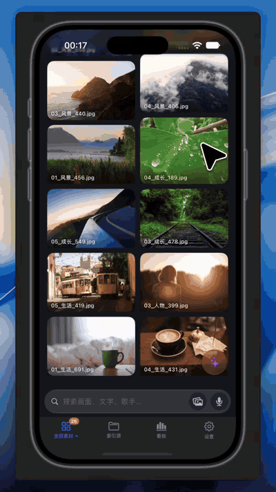
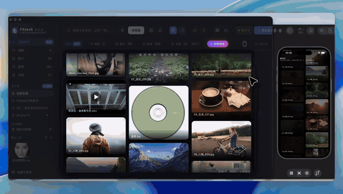

# FXseek

**A self-contained, fully local media library for macOS — find the photos, videos, audio and documents on your disk by describing them, by speaking (or humming), or by showing it a reference image. Pair your iPhone and the library follows you around the house.**

Indexing, tagging and transcription all run **on your own machine**; nothing leaves it. There is no Python to install and no dependency to manage — the app ships with its own runtime and a built-in multimodal model.

**English** · [简体中文](README.md)

```
"a picture with balloons"     → finds that photo, and tells you why it matched
hold to speak "find the dog"  → voice → intent → search
hum a chorus                  → humming search: acoustic fingerprint pinpoints that track
drop in a reference image     → reverse image search; videos jump to the matching frame
```

---


## Three demos

**① Search by describing the picture** — type "dog" or "knitwear"; results carry a **match score**, and double-clicking the search box brings up your history:


▶ [Full demo · 45 s (with audio, 1600×900)](../../releases/download/v1.0.3/FXseek-search-demo.mp4)

**② Make it yours** — light / dark theme and 简体中文 / English switch in one click; thumbnail wall, list view and detail pane whenever you want them:


▶ [Full demo · 22 s (with audio)](../../releases/download/v1.0.3/FXseek-ui-tour.mp4)

**③ Memory Lane** — an ambient gallery that keeps only photos and videos, drifting slowly in staggered columns; click any tile and it fades away:


▶ [Full demo · 30 s (with audio)](../../releases/download/v1.0.3/FXseek-memory-lane.mp4)

> The full videos (with audio, 1600×900) live in [Releases](../../releases) next to the installer.
> The GIFs are downscaled to 620px for load time — see the videos above, or the stills below, for detail.

### Stills (easier on the eyes)

| Light theme · English | Memory Lane |
|---|---|
|  |  |

## What it does

| | Capability |
|---|---|
| 🔍 **Search by describing the picture** | Not just filenames: vector search understands *what is in the frame* ("water at sunset", "sweat on a palm"), then re-ranks. |
| 🎙 **Voice search** | Hold a key, say what you want. **Humming search** goes through an acoustic fingerprint (Chromaprint). Fingerprint first, intent routing, two fallbacks. |
| 🖼 **Reverse image search / search by audio** | Hand it one picture or one clip and get similar assets back; when it hits a video, the cover *is* the matching frame. |
| 📱 **iPhone app** | Browse, search (text / image / voice) and play the whole library from your phone over Wi-Fi — the phone's own photos and voice memos show up on the desktop as a normal index source, and tagging or transcription can run on either machine. **The phone keeps a local index, so reverse image search, audio search and semantic search still work with no Wi-Fi at all — on-device, offline.** |
| 🗂 **30+ formats** | 8 image, 8 video, 8 audio formats, plus PDF / Office / WPS / plain text / archive listings. |
| 🎬 **More than search** | Thumbnail wall, built-in player, recent uploads, trash. |
| 📜 **One transcript panel, audio and video alike** | The player has a collapsible **Transcript** panel — audio calls it the lyric view, video slides it out beside the picture (and the video actually *gives up width* rather than hiding text behind it). Same component, so both get the *Original / Polished* switch, *Re-polish*, *Re-transcribe* and *Revert*. The video **subtitle overlay** is driven from the same transcript, so polishing updates the subtitles too. The right-hand detail pane is read-only: it shows the text and points you at the player instead of stacking a row of buttons. |
| 🪄 **AI polish for transcripts** | Transcription is never perfect. Hand a transcript to your local chat model and it *fixes typos, restores punctuation, and labels who is speaking* — songs get lyrics treatment, interviews get `Speaker A:`. **The original is always kept**: the polished text sits beside it, both are searchable, and one click reverts. "Polish all" has an **idle gate** (on by default): it waits until you have stopped using the app for `idle_minutes`, pauses the moment you come back, and picks up where it left off — so it never fights your keyboard for the GPU. |
| 🎯 **Word-level alignment for transcripts** | Polishing fixes the *text*; this fixes the *timing*. A forced-alignment model (Qwen3-ForcedAligner-0.6B, ~1.2 GB, downloaded the first time you turn it on) locates every character inside the audio, so the lyric highlight and the video subtitles follow individual words instead of jumping one whole line at a time. It is honest about silence: if the first word lands at 0:22, **nothing is highlighted for the first 22 seconds** — the old even-split guess would happily point at line 3 of a song that hadn't started yet. Runs as a one-shot subprocess when the background queue has nothing better to do, so the model never sits in memory. Best on Chinese lyrics; Japanese and Korean are not supported yet. |
| 🎨 **Highlight style and colour** | A palette button next to the transcript switches the highlight between **word-by-word**, **whole-line**, and **off** (subtitles still show — they just stop changing colour), with five presets that sit inside the app's existing palette. Audio and video share one setting and it applies live during playback. "Word-by-word" is greyed out only when there is genuinely nothing to follow — and both the **original** and the **polished** transcript get their own timing (the offsets are remapped across the edit with a diff), so turning polishing on no longer costs you word-level highlighting |
| ✨ **Memory Lane** | A one-click "corridor of memories": photos and videos only, drifting in staggered columns; click one to let it fade out. |
| 🤖 **Hook it up to local AI agents** | A built-in MCP server, with one-click detection and setup for 6 agents (DSH, Codex, Claude Code, …). |
| 🌗 **Everyday comfort** | Bilingual UI, light/dark themes (optionally following the time of day), index-source management, a local HTTP API. |
| 🔄 **Update check** | *About → Check for updates* compares your build against GitHub Releases. If it can't reach GitHub (offline, blocked, rate-limited) it says so plainly and reveals a **releases** button that opens the page in your browser — it never fakes a "you're up to date". |
| 🪶 **Light on memory** | The ~3.5 GB multimodal model is **loaded on demand** — launching the app costs a few tens of MB, not gigabytes, so an 8 GB Mac stays responsive. It loads on your first search (a second or two) and is **released again after it has been idle** (default 5 min, configurable); searching repeatedly within that window reuses the one copy. |

> The quiet but important part: **not a single search request ever leaves this machine.** Privacy-first is not
> a slogan here — the bundled WEMM-Embedding-2B model runs locally, and transcription only ever talks to the
> local or self-hosted service *you* point it at.

## Under the hood

- **Two on-device embedding models, switchable and side by side** — desktop retrieval runs **WEMM-Embedding-2B**
  (wemm-2b, 2048-dim, the more accurate one); the phone's offline retrieval runs **EG2 / EmbeddingGemma 2**
  (Google's 740M multimodal encoder: 270M text + 170M vision + 300M audio, 768-dim, ~1.2 GB of MLX 8-bit weights;
  on iPhone it can run on the ANE through Core ML). They are **not the same vector space**, so the desktop
  re-encodes the whole library with the same EG2 and syncs it to the phone incrementally by revision — which is
  what lets the phone do **reverse image search, audio search and semantic search entirely on-device, offline** —
  while desktop search itself keeps using WEMM. Nothing is disturbed on either side.
- **Three-stage retrieval**: filename → vectors → deep re-rank, so long-tail descriptions still land.
- **Hybrid scoring**: vectors + keywords + type/time filters, with guards for empty queries and cold caches.
- **Word-level timeline**: Qwen3-ForcedAligner-0.6B forced alignment, so lyrics and subtitles follow individual
  characters — and it stays honest about silence.
- **Zero upload**: all inference is local; keys, assets and indexes never leave the device. In LAN mode the phone
  is still looking at the library on *your* Mac.

## Download

1. Grab `FXseek-1.1.0.dmg` from [Releases](../../releases) — the phone build is `FXseekMobile/dist/FXseekMobile-1.1.0.ipa` in this repo, see [iPhone / iPad](#-iphone--ipad) below
2. **Delete any older copy first**: `/Applications/FXseek.app` (installing over it leaves stale files behind)
3. Open the dmg and drag `FXseek.app` into *Applications*
4. On first launch it **downloads the built-in model (~1.8 GB)** automatically, with a progress bar; it tries a mirror first and falls back to the official source
5. The app is not notarised by Apple, so if Gatekeeper blocks the first launch, **right-click → Open** (or allow it under *System Settings → Privacy & Security*)

**Requires**: Apple Silicon (M-series) + macOS 13 or newer. Verified on an Apple M4.

### Downloading from mainland China

GitHub's release CDN can be slow or unreachable there. These mirrors serve the exact same file:

| Route | Link |
|---|---|
| ⚡ Mirror 1 | `https://ghfast.top/https://github.com/FRr688/FXseek/releases/download/v1.1.0/FXseek-1.1.0.dmg` |
| ⚡ Mirror 2 | `https://hk.gh-proxy.com/https://github.com/FRr688/FXseek/releases/download/v1.1.0/FXseek-1.1.0.dmg` |
| ⚡ Mirror 3 | `https://ghproxy.net/https://github.com/FRr688/FXseek/releases/download/v1.1.0/FXseek-1.1.0.dmg` |
| 🌐 Direct | `https://github.com/FRr688/FXseek/releases/download/v1.1.0/FXseek-1.1.0.dmg` |

The mirrors are third-party proxies — they may be unavailable at any time. If none of them work, try the
direct link, or use any GitHub accelerator you trust by prefixing it to the direct URL.

**File integrity** (350.3 MB / 367,309,446 bytes):

```bash
shasum -a 256 ~/Downloads/FXseek-1.1.0.dmg
# 0f7aac8a203741bc0581402c0e5f649f4a2339a5faf6bef13be8277e9635ec1e
```

## 📱 iPhone / iPad

Once FXseek is running on the Mac, the phone can use the same library over **a direct LAN connection**:
browse, search (text / image / audio) and play the whole library from your phone. **Phone ⇄ Mac transfer** goes
both ways — the phone's own photos, voice memos and files can be pushed into a desktop index source, and desktop
assets can be saved onto the phone to take with you. The phone keeps a **local index**, so once you leave the
house it still searches with no Wi-Fi at all (on-device, offline). Pairing is a one-time 6-digit code exchanged
for a long-lived token, and everything off the loopback interface requires that token — **the library itself never
leaves your LAN**.

### What it looks like, and how it pairs

| Phone UI | Phone ⇄ Mac over Wi-Fi |
|:--:|:--:|
|  |  |
| Grid browsing, audio cards, search by picture — all offline | Type the 6-digit code from the Mac and the phone joins the same library; a phone panel shows up on the desktop |

Full demo videos (1080p, 25–30 s each): [phone UI](https://github.com/FRr688/FXseek/releases/download/v1.1.0/fxseek-demo-phone-ui.mp4) · [pairing](https://github.com/FRr688/FXseek/releases/download/v1.1.0/fxseek-demo-pairing.mp4)

### Sideloading it (5 steps)

Free the whole way; no developer account needed. A sideloaded build is good for **7 days** — sign it again when it
expires, or let AltStore renew it for you automatically.

1. **Get the build** — [`FXseekMobile/dist/FXseekMobile-1.1.0.ipa`](FXseekMobile/dist/FXseekMobile-1.1.0.ipa) (~25 MB, [direct link](https://raw.githubusercontent.com/FRr688/FXseek/main/FXseekMobile/dist/FXseekMobile-1.1.0.ipa)). The phone app is **free, binary only — its source is not published** (the same file will also sit in the release assets)
2. **Install a signing tool** — [Sideloadly](https://sideloadly.io) (most reliable, sign once over a cable) · [AltStore](https://altstore.io) (auto-renew, same Wi-Fi) · [TrollStore](https://github.com/opa334/TrollStore) (iOS ≤ 16.6.1, permanent)
3. **Sign it onto the phone** — connect the iPhone with a cable and tap *Trust*; open Sideloadly and drag the ipa into the window; put your normal Apple ID in the **Apple ID** field (the password only ever goes to Apple's signing service); hit **Start** until it says **Done**
4. **Allow it on the phone** — Settings → General → **VPN & Device Management** → pick your Apple ID → **Trust**; on iOS 16+ also Settings → Privacy & Security → **Developer Mode** → on, then restart once
5. **Try it** — open FXseek → the **On this device** tab at the bottom → drop in a couple of songs or photos → play one → hit the lock button and check for *Previous / Next* on the lock screen

> ⚠️ **If your signing tool reports `Login failed (-80045)`: it is not your mistake.** Since 12 Oct 2026 Apple's
> account-verification endpoint has been refusing sign-ins, so every sideloading tool (Sideloadly / AltStore /
> SideStore…) fails with that same code — the failure is at the *login* step, before anything is signed. Switch
> Sideloadly's anisette from Local to Remote, or install the same ipa with [iloader](https://github.com/nab138/iloader/releases);
> don't hammer retries with the same Apple ID (Apple rate-limits them). Details: [`FXseekMobile/dist/用户装包指引.md`](FXseekMobile/dist/用户装包指引.md) *(Chinese)*.

- 📖 Full walkthrough and FAQ: [`FXseekMobile/dist/用户装包指引.md`](FXseekMobile/dist/用户装包指引.md) *(Chinese)*
- 🧩 **No computer needed** (AltStore source): paste this line into AltStore's `Browse → Sources → +` and you get one-tap installs with automatic re-signing:

```
https://raw.githubusercontent.com/FRr688/FXseek/main/FXseekMobile/dist/altstore.json
```

  The source file is the repository's own [`FXseekMobile/dist/altstore.json`](FXseekMobile/dist/altstore.json) (the `.ipa` and icon live in the same folder).

**Phone build integrity** (24.9 MB / 26,143,063 bytes, build 38):

```bash
shasum -a 256 ~/Downloads/FXseekMobile-1.1.0.ipa
# 47758b12f7f0db08fc8616bddc4c6c7d9cb807629df15c898f9cab834150e663
```

## Building from source

The repository holds **source only**. To build a runnable `.app` / `.dmg` you need three things in the
repository root — `venv/`, `bin/` and `model/` — all of which are `.gitignore`d.
**Full step-by-step instructions, including two pitfalls we actually hit**, are in
→ [docs/building.md](docs/building.md).

```bash
bash tools/build_app.sh          # .app only
bash tools/build_app.sh --dmg    # .app + .dmg
hdiutil verify dist/FXseek-1.1.0.dmg     # must print VALID

# Dev mode: run the server directly; edits to ui.html / settings.html apply on refresh
./venv/cpython-3.11/bin/python3.11 app.py --port 8231

# Dependency audit (run this before touching the packaging slim-down list)
./venv/cpython-3.11/bin/python3.11 tools/audit_deps.py
```

## Project layout

| Path | What it is |
|---|---|
| `app.py` | HTTP server + web UI + search API (stdlib only; the front end is re-read from disk per request, so edits apply on refresh) |
| `indexer.py` / `fastsearch.py` | Index construction + three-stage retrieval (filename → vectors → deep re-rank) |
| `embed.py` / `serve.py` | Model loading and self-check / OpenAI-compatible local embedding service |
| `eg2.py` / `mobile.py` | EG2 vector table and incremental sync (phone offline search) / pairing, mDNS advertising and LAN auth |
| `voice_intent.py` / `fingerprint.py` / `recorder.py` | Spoken-intent classification (pure numpy), acoustic fingerprinting, microphone capture |
| `model_dl.py` | First-launch model download (two sources, resumable, with progress — EG2 included) |
| `mcp_server.py` / `mcp_agents.py` / `fxseek_skill/` | Exposes the library to local AI agents |
| `launcher.py` / `tray_helper.py` | Native launcher (Mach-O, so microphone permission is attributed correctly) and menu-bar helper |
| `ui.html` / `settings.html` / `i18n.js` / `icons.js` | Front end (no build step, plain JS) |
| `tools/` | Packaging scripts, dependency audit, native launcher source, sample-asset generator |
| `FXseekMobile/dist/` | The phone app's **binary and install guide** (`FXseekMobile-1.1.0.ipa`, `altstore.json`, `用户装包指引.md`); **the app's source is not published** — `eg2.py` / `mobile.py` above are the Mac side (offline vector table and LAN sync protocol) |
| `docs/` | [Building guide](docs/building.md) · [engineering notes](docs/手册.md) *(Chinese)* · [runtime & binaries](docs/运行时与二进制.md) · [mobile protocol](docs/手机版协议.md) · [demo assets](docs/demo/) |

## License (important)

- **The phone app (iPhone / iPad) is free to use but closed source**: this repo ships only its binary (`FXseekMobile/dist/`), never the app source. This repository open-sources the Mac app only.
- **Supporting development, or need unlimited items:** the paid edition is on [Afdian](https://ifdian.net/item/f9d058d0c70111f199f15254001e7c00) (¥29.9 one-time, one computer). The free edition is capped at 2,000 items and one phone; sharing keeps extending it. **The iOS app is always free** and is not sold there.
- The Mac app is released under the **PolyForm Noncommercial License 1.0.0** ([LICENSE](LICENSE)):
  free to use and modify for **personal study, research, hobby projects, charity, education, public
  research and government** use.
- **Any commercial use requires a separate license** (internal company use, shipping it with a product,
  SaaS, contract development, …) → see **[COMMERCIAL.md](COMMERCIAL.md)** for terms and pricing.
- Licenses for bundled and third-party components and models are listed in **[THIRD-PARTY.md](THIRD-PARTY.md)**
  — check it before distributing, especially for FFmpeg, Chromaprint and the bundled model.

---

[简体中文 →](README.md)
