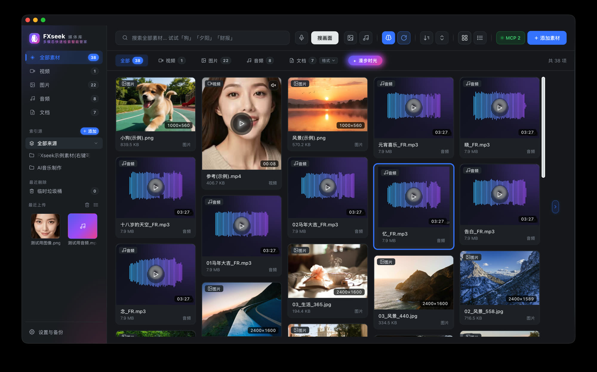
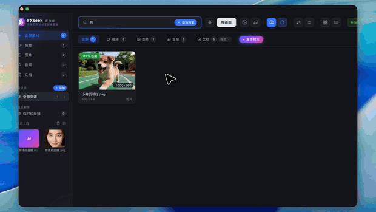
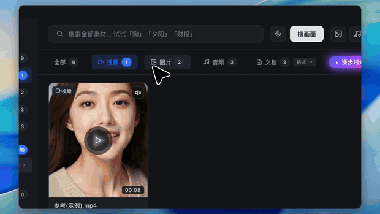
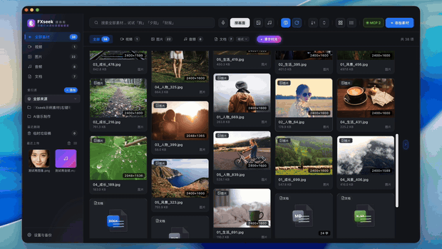
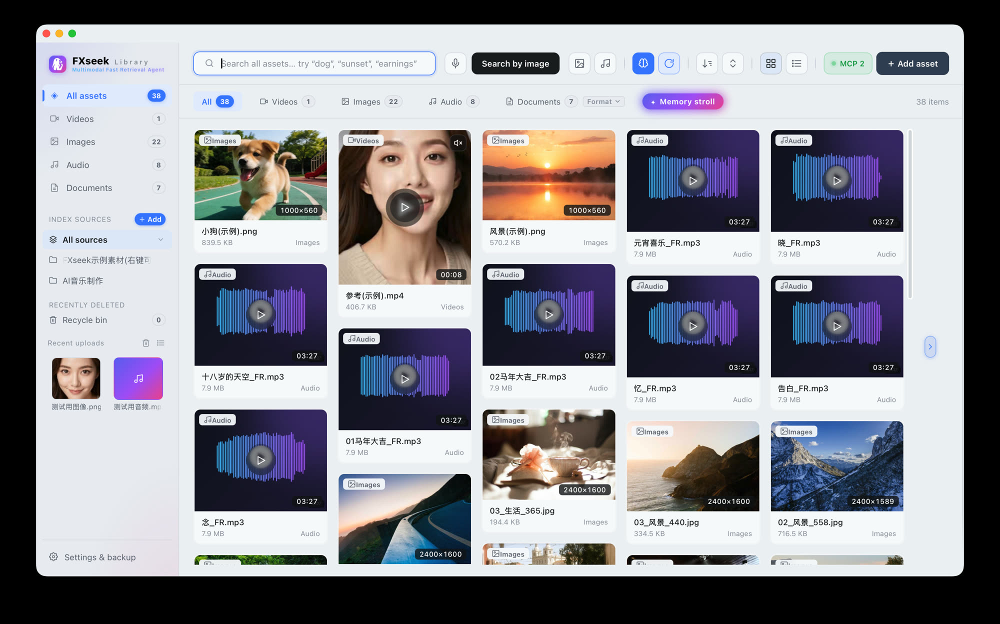
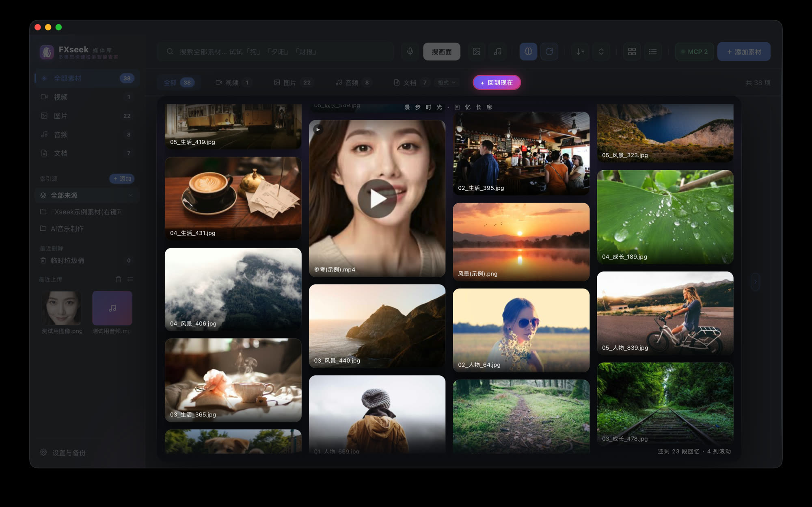

# FXseek

**一个自包含、完全跑在本机的 macOS 素材库 —— 用一句话描述画面、用说话（或者干脆哼一段），也可以直接丢一张参考图，就能找到硬盘里的图片、视频、音频和文档。配上 iPhone，媒体库跟着你在家里走。**

索引、打标、转写**全部在你自己的机器上完成，素材不出网**；不用装 Python，也不用管依赖 ——
应用自带独立运行时和内置多模态模型。

**简体中文** · [English](README.en.md)

```
「有气球的画面」        → 找到那张图，并告诉你它为什么匹配
按住说「找狗的照片」     → 语音 → 意图 → 检索
哼一段副歌             → 哼唱搜索：声学指纹直接定位那首歌
丢一张参考图进来        → 以图搜图；命中视频时直接跳到那一帧
```

---



## 三段演示

**① 打字就能搜画面** —— 输入「狗」「针织衫」，结果带**匹配度角标**；搜索框里双击还能唤出搜索历史：


▶ [完整演示 · 45 秒（有声，1600×900）](../../releases/download/v1.0.3/FXseek-search-demo.mp4)

**② 界面随你** —— 白天 / 夜间主题、简体中文 / English，点一下就换；缩略图墙、列表视图、详情区随意切换：


▶ [完整演示 · 22 秒（有声）](../../releases/download/v1.0.3/FXseek-ui-tour.mp4)

**③ 漫步时光** —— 只留图片与视频，按列交错缓缓滚动；点任意一张，它会优雅地淡出：


▶ [完整演示 · 30 秒（有声）](../../releases/download/v1.0.3/FXseek-memory-lane.mp4)

> 完整演示视频（有声 · 1600×900）与安装包一起放在 [Releases](../../releases)；
> 动图为了加载速度压到 620px，看细节请点上面的完整视频或下面的原图。

### 静态截图（看得更清楚）

| 白天主题 · English | 漫步时光 · 回忆长廊 |
|---|---|
|  |  |

## 能做什么

| | 能力 |
|---|---|
| 🔍 **文字搜画面** | 不只搜文件名：向量检索看得懂**画面里有什么**（「夕阳下的水面」「手心里的汗珠」），再做深度精排。 |
| 🎙 **语音 / 哼唱搜索** | 按住一个键，说出你想要什么；**哼唱搜索**直接走声学指纹（Chromaprint）。指纹优先、意图分流、两路兜底。 |
| 🖼 **以图搜图 / 以音搜素材** | 给一张图或一段音频，拿回库里相似的素材；命中视频时，封面**就是**那一帧。 |
| 📱 **iPhone App** | 在手机上通过 Wi-Fi 浏览、检索（文字 / 以图 / 以音）和播放整个库；手机自己的照片和语音备忘录在电脑端就是一个普通的索引源，打标和转写两边都能跑。**手机保留一份本地索引，断网也能以图搜图、以音搜素材和语义检索 —— 端侧离线可用。** |
| 🗂 **30+ 格式** | 图片 8 种、视频 8 种、音频 8 种，外加 PDF / Office / WPS / 纯文本 / 压缩包清单。 |
| 🎬 **不只是搜** | 缩略图墙、内置播放器、最近上传、回收站。 |
| 📜 **音频视频共用一套转写面板** | 播放器里有可折叠的**转写**面板 —— 音频叫歌词页，视频则在画面旁滑出（而且视频是**真的让出宽度**，不是把文字盖在上面）。同一个组件，所以两边都有*原文 / 优化*切换、*重新优化*、*重新转写*和*还原*。视频**字幕**由同一份转写驱动，优化完字幕一起更新。右侧详情栏是只读的：它展示文本，并把你引向播放器，而不是再堆一排按钮。 |
| 🪄 **转写 AI 润色** | 转写从来不是完美的。把一段转写交给你的本地对话模型，它会*改错字、补标点、标出谁在说话* —— 歌曲按歌词处理，访谈得到 `Speaker A:`。**原文永远保留**：优化后的文本并排放在旁边，两份都能搜，一键还原。「全部优化」带**空闲闸门**（默认开）：等你不碰应用 `idle_minutes` 之后才跑，你一回来就暂停，回来后接着上次继续 —— 绝不跟你的键盘抢 GPU。 |
| 🎯 **转写逐字对齐** | 润色修的是*文字*，这一步修的是*时间*。强制对齐模型（Qwen3-ForcedAligner-0.6B，约 1.2 GB，第一次开启时下载）把每个字定位到音频里，于是歌词高亮和视频字幕跟着**单个字**走，而不是整行整行地跳。它对静音很诚实：如果第一个字落在 0:22，**前 22 秒什么都不会高亮** —— 旧的均分猜法会理直气壮地指着一首还没开始唱的歌的第 3 行。它在后台队列没别的事可做时以一次性子进程运行，所以模型不常驻内存。中文歌词效果最好；暂不支持日语和韩语。 |
| 🎨 **高亮样式与配色** | 转写旁边的调色盘按钮把高亮切成**逐字**、**整行**和**关闭**（字幕照常显示，只是不再变色），另有五套落在应用现有配色里的预设。音频与视频共用一个设置，播放时实时生效。「逐字」只在确实没有东西可跟时才置灰 —— 而且**原文**和**优化后**的转写各有自己的时间轴（偏移量用 diff 重新映射过），所以打开润色不再以丢掉逐字高亮为代价。 |
| ✨ **漫步时光** | 一键进入「回忆长廊」：只留图片和视频，按列交错缓缓滚动；点一张，让它优雅地淡出。 |
| 🤖 **接给本机 AI Agent** | 内置 MCP server，6 个 Agent（DSH、Codex、Claude Code……）一键检测与配置。 |
| 🌗 **日常体验** | 中英双语界面、深浅色主题（可跟随时间）、索引源管理、本地 HTTP API。 |
| 🔄 **检查更新** | *关于 → 检查更新* 拿你的版本号和 GitHub Releases 比对。连不上 GitHub（离线、被墙、限流）它会直说，并露出一个 **releases** 按钮用浏览器打开 —— 它从不会假装「你已是最新」。 |
| 🪶 **内存友好** | 约 3.5 GB 的多模态模型是**按需加载**的 —— 启动只要几十 MB，不是几个 GB，8 GB 的 Mac 也照样流畅。第一次搜索时加载（一两秒），空闲一段时间后**再释放**（默认 5 分钟，可配置）；这段时间里反复搜索复用同一份。 |

> 低调但重要的一点：**没有一条检索请求会离开这台机器。** 隐私优先不是一句口号 ——
> 内置的 WEMM-Embedding-2B 在本地跑，转写也只连你自己指定的本地 / 自建服务。

## 技术一览

- **两套端侧嵌入模型，可切换、可并存** —— 桌面检索走 **WEMM-Embedding-2B**（wemm-2b，2048 维，精度更高）；
  手机端离线检索走 **EG2 / EmbeddingGemma 2**（Google 的 740M 多模态编码器：文本 270M + 视觉 170M + 音频 300M，
  768 维，MLX 8bit 权重约 1.2 GB，iPhone 上可用 Core ML 走 ANE）。两者**不是同一个向量空间**，
  所以桌面会用同一个 EG2 把全库再算一遍、按版本增量同步给手机 —— 手机因此**端侧离线**也能以图搜图、
  以音搜素材和语义检索，而桌面自己的检索仍然走 WEMM，互不干扰。
- **三级检索管线**：文件名 → 向量 → 深度重排（deep re-rank），长尾描述也能命中。
- **混合打分**：向量 + 关键词 + 类型 / 时间过滤；空查询、冷缓存都有兜底，不会卡住。
- **逐字时间轴**：Qwen3-ForcedAligner-0.6B 强制对齐，歌词高亮与视频字幕跟到字，且对静音诚实。
- **零上传**：推理全在本机，密钥、素材、索引都不出设备；局域网模式下手机看到的也是你自己电脑上的库。

## 下载

1. 到 [Releases](../../releases) 下载 `FXseek-1.1.0.dmg`（手机端是仓库里的 `FXseekMobile/dist/FXseekMobile-1.1.0.ipa`，见下方[手机端](#-手机端iphone--ipad)）
2. **安装前先删掉旧版**：`/Applications/FXseek.app`（直接覆盖会留下旧文件）
3. 打开 dmg，把 `FXseek.app` 拖进「应用程序」
4. 首次启动会**自动下载内置模型（约 1.8 GB）**，默认走国内镜像、失败自动换官方源，带进度条
5. 未做 Apple 开发者签名，第一次打开若被拦，请**右键 → 打开**（或到「系统设置 → 隐私与安全性」里允许）

**要求**：Apple Silicon（M 系列）+ macOS 13 或更高。已在 Apple M4 上验证。

### 国内加速下载

GitHub 的下载线路在国内可能很慢甚至连不上。下面几个镜像给的是**完全相同的文件**：

| 线路 | 地址 |
|---|---|
| ⚡ 加速 1 | `https://ghfast.top/https://github.com/FRr688/FXseek/releases/download/v1.1.0/FXseek-1.1.0.dmg` |
| ⚡ 加速 2 | `https://hk.gh-proxy.com/https://github.com/FRr688/FXseek/releases/download/v1.1.0/FXseek-1.1.0.dmg` |
| ⚡ 加速 3 | `https://ghproxy.net/https://github.com/FRr688/FXseek/releases/download/v1.1.0/FXseek-1.1.0.dmg` |
| 🌐 官方直链 | `https://github.com/FRr688/FXseek/releases/download/v1.1.0/FXseek-1.1.0.dmg` |

镜像都是第三方代理，随时可能失效；如果都打不开，就用官方直链，或者拿你信得过的 GitHub 加速前缀
拼在直链前面。建议**先试加速、慢就换直链**。

**完整性核对**（文件 349.5 MB / 366,472,614 字节）：

```bash
shasum -a 256 ~/Downloads/FXseek-1.1.0.dmg
# 应为 daf4130fa02a86ed5ae9776bd7be6e437170c2206a86c374daa9a47af1972adb
```

## 📱 手机端（iPhone / iPad）

电脑装上 FXseek 之后，手机也能用同一个库：**局域网直连**，在手机上浏览、检索（文字 / 以图 / 以音）和播放
整个素材库；**手机 ⇄ 电脑互传** —— 手机自己的照片、录音、文件可以直接传进电脑的索引源，电脑上的素材也能
存到手机里带走；手机保留一份**本地索引**，所以出了家门、断网也照样能搜（端侧离线）。
配对走 6 位一次性配对码换长期令牌，回环以外的请求都要令牌，**库本身不出局域网**。

### 装到 iPhone 上（5 步，小白版）

全程免费，不需要开发者账号。装好后有效期 **7 天**，到期重签一次即可（用 AltStore 会自动续签）。

1. **下载安装包** —— [`FXseekMobile/dist/FXseekMobile-1.1.0.ipa`](FXseekMobile/dist/FXseekMobile-1.1.0.ipa)（约 25 MB，[直链](https://raw.githubusercontent.com/FRr688/FXseek/main/FXseekMobile/dist/FXseekMobile-1.1.0.ipa)）。手机端**免费、只发安装包，源码不公开**（Release 建好后附件里也会放同一份）
2. **装一个签名工具** —— [Sideloadly](https://sideloadly.io)（通用最稳，插线签一次）· [AltStore](https://altstore.io)（自动续签，同一个 Wi-Fi）· [TrollStore](https://github.com/opa334/TrollStore)（iOS ≤ 16.6.1，装完永久有效）
3. **把 App 签进手机** —— 数据线连上 iPhone、手机上点「信任此电脑」；打开 Sideloadly，把 ipa 拖进窗口；**Apple ID** 填你平时下 App 的那个账号（密码只发给苹果官方签名服务）；点 **Start**，出现 **Done** 就成了
4. **手机上允许它** —— 设置 → 通用 → **VPN 与设备管理** → 选你的 Apple ID → **信任**；（iOS 16+）设置 → 隐私与安全性 → 拉到底 → **开发者模式** → 打开，手机重启一次
5. **试一下** —— 打开 FXseek → 底部「**本机素材**」→ 先放一两首歌或几张图进去 → 播放 → 按锁屏键，看锁屏上有没有「上一首 / 下一首」

> ⚠️ **如果签名工具报 `Login failed (-80045)`：不是你弄错了。** 2026 年 10 月 12 日起苹果的账号验证接口在拒签，
> 全球所有侧载工具（Sideloadly / AltStore / SideStore…）都报同一个错，报错点在「登录」那一步、还没走到签名。
> 先把 Sideloadly 的 anisette 从 Local 换成 Remote，或者用 [iloader](https://github.com/nab138/iloader/releases) 装同一个 ipa；
> 别对同一个账号连续重试（苹果会限流）。细节见[用户装包指引](FXseekMobile/dist/用户装包指引.md)。

- 📖 图文详情与常见问题：[`FXseekMobile/dist/用户装包指引.md`](FXseekMobile/dist/用户装包指引.md)
- 🧩 **免电脑安装**（AltStore 源）：把下面这一行贴进 AltStore 的 `Browse → Sources → +`，之后就能一键安装、自动续签：

```
https://raw.githubusercontent.com/FRr688/FXseek/main/FXseekMobile/dist/altstore.json
```

  源文件就是仓库里的 [`FXseekMobile/dist/altstore.json`](FXseekMobile/dist/altstore.json)（`.ipa` 与图标也在同一个目录）。

**手机端完整性核对**（文件 24.9 MB / 26,142,315 字节，构建 37）：

```bash
shasum -a 256 ~/Downloads/FXseekMobile-1.1.0.ipa
# 应为 e4ad2cd50324a4156f88e3d88db20e40891c84e3a6b401c94dd3443785ff883b
```

## 从源码构建

仓库只放源码，构建前需要自备三样东西（都已被 `.gitignore` 忽略）：
`venv/`（自包含 CPython 3.11 + 依赖）、`bin/`（ffmpeg / ffprobe / fpcalc）、`model/`（可让首次启动自动下载）。
**完整步骤与两个真实踩过的坑**见 → [docs/building.md](docs/building.md)。

```bash
bash tools/build_app.sh          # 只出 .app
bash tools/build_app.sh --dmg    # 出 .app + .dmg
hdiutil verify dist/FXseek-1.1.0.dmg     # 必须打印 VALID

# 开发模式：直接起服务，改 ui.html / settings.html 刷新即生效
./venv/cpython-3.11/bin/python3.11 app.py --port 8231

# 依赖体检（改打包瘦身列表前务必先跑，见文档里的「空壳元数据」坑）
./venv/cpython-3.11/bin/python3.11 tools/audit_deps.py
```

## 项目结构

| 路径 | 说明 |
|---|---|
| `app.py` | HTTP 服务 + Web UI + 检索 API（纯标准库；每请求从磁盘读前端，改完刷新即生效） |
| `indexer.py` / `fastsearch.py` | 索引构建 + 三级检索（文件名 → 向量 → 深度重排） |
| `embed.py` / `serve.py` | 模型加载与自检 / OpenAI 兼容的本地向量服务 |
| `eg2.py` / `mobile.py` | EG2 向量表与增量同步（手机端离线检索）/ 手机配对、mDNS 广播与局域网鉴权 |
| `voice_intent.py` / `fingerprint.py` / `recorder.py` | 语音意图判别（纯 numpy）、声学指纹、麦克风采集 |
| `model_dl.py` | 首次启动的模型下载（双源 + 断点 + 进度，含手机向量模型 EG2） |
| `mcp_server.py` / `mcp_agents.py` / `fxseek_skill/` | 把媒体库接给本机 AI Agent |
| `launcher.py` / `tray_helper.py` | 原生启动器（Mach-O，保证麦克风权限归属正确）、菜单栏 |
| `ui.html` / `settings.html` / `i18n.js` / `icons.js` | 前端（零构建、原生 JS） |
| `tools/` | 打包脚本、依赖体检、原生启动器源码、示例素材生成 |
| `FXseekMobile/dist/` | 手机端的**安装包与安装指引**（`FXseekMobile-1.1.0.ipa`、`altstore.json`、`用户装包指引.md`）；**App 源码不公开**，这里的 `eg2.py` / `mobile.py` 是电脑端那一侧（离线向量表与局域网同步协议） |
| `docs/` | [工程手册](docs/手册.md)（设计取舍与踩坑）· [构建指南](docs/building.md) · [运行时与二进制](docs/运行时与二进制.md) · [手机版接口协议](docs/手机版协议.md) · [演示素材](docs/demo/) |

## 许可（重要）

- **手机端（iPhone / iPad App）免费使用，但源码不公开**：仓库里只有它的安装包（`FXseekMobile/dist/`），没有 App 源码；本仓库开源的是电脑端。
- 电脑端采用 **PolyForm Noncommercial License 1.0.0**（[LICENSE](LICENSE)）：
  **个人学习 / 研究 / 业余爱好 / 慈善 / 教育 / 公共研究 / 政府**等非商业用途 —— 免费，随便用、可以改。
- **任何商业用途都需要单独授权**（公司内部使用、随产品分发、SaaS、二次开发交付……）
  → 用途、报价与常见问题见 **[COMMERCIAL.md](COMMERCIAL.md)**。
- **想支持一下开发，或者需要不限条数的「专业版」**：在 [爱发电](https://ifdian.net/item/f9d058d0c70111f199f15254001e7c00) 购买（¥29.9，一次买断、一台电脑一份）。免费版限 2,000 条素材与 1 台手机，每天分享给朋友 / 转发朋友圈还能换使用天数；**手机端始终完全免费**，不在这里卖。
- 内置 / 依赖的第三方组件与模型许可见 **[THIRD-PARTY.md](THIRD-PARTY.md)**
  （特别是 FFmpeg、Chromaprint 与内置模型的许可 —— 商用分发前请务必核对）。

---

[English →](README.en.md)
